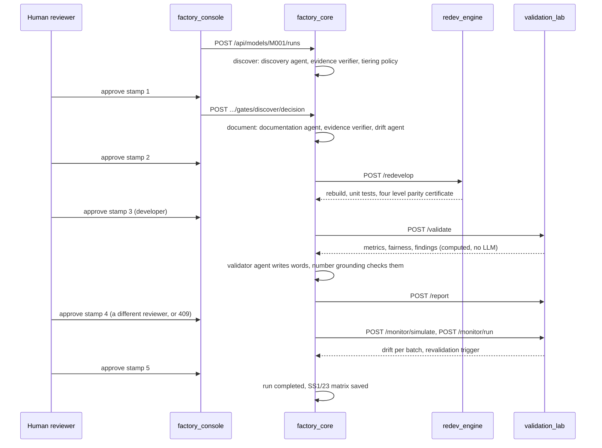

# ModelPassport architecture

Four services, one owner each. Services exchange JSON over HTTP and file paths on a shared disk. There is no shared code package. The contracts are in section 9 of [`PROJECT_CONTEXT.md`](PROJECT_CONTEXT.md).

```mermaid
flowchart TB
    reviewers["Human reviewers<br/>developer, validator, owner"] --> console
    console["factory_console<br/>React dashboard, port 5173<br/>modes: mock, live, snapshot"]
    console -->|"HTTP JSON, section 9.3"| core

    subgraph core["factory_core, FastAPI, port 8000"]
        api["REST API for the dashboard"]
        graph["LangGraph pipeline<br/>5 stages, a human gate after each"]
        agents["Agents: discovery, documentation,<br/>document drift, validator"]
        checks["Code checks: evidence verifier,<br/>number grounding, tiering policy"]
        store[("SQLite: inventory, runs,<br/>hash chained audit trail")]
    end

    core -->|"POST /redevelop"| redev["redev_engine, port 8001<br/>analyse, translate, test, parity proof"]
    core -->|"POST /validate, /report,<br/>/monitor/simulate, /monitor/run"| lab["validation_lab, port 8002<br/>metrics, fairness, report, monitoring<br/>no LLM"]
    core --> llm["LLM provider<br/>any OpenAI compatible endpoint"]
    redev --> llm
    estate[("model_estate/<br/>legacy code, old documents,<br/>data, golden outputs")]
    artifacts[("artifacts/<br/>run outputs")]
    core --- estate
    redev --- estate
    lab --- estate
    core --- artifacts
    redev --- artifacts
    lab --- artifacts
    mlflow["MLflow, optional"] -.- redev
    mlflow -.- lab
    snapshot["Public demo link<br/>static snapshot, no backend"] -.- console
```

## One run, stage by stage



Each stage moves `PENDING` to `RUNNING` to `AWAITING_REVIEW`, and the run pauses until a human approves or rejects. A rejection stops the run; a failure is shown with its error. A stage that does not apply (for example redevelopment of a Python model) is `SKIPPED` with a reason and needs no gate. The run id is the LangGraph thread id, and a SQLite checkpointer keeps a paused run across restarts.

## Where the design rules are enforced

| Rule | Mechanism |
|---|---|
| Every claim is cited | Agents must give file, lines and an exact quote for each claim. factory_core's evidence verifier looks the quote up in the cited file, corrects wrong line numbers, and marks failures `UNVERIFIED` or `SME_INPUT_NEEDED`. Groundedness is the share of verified claims, computed by code. |
| Every number is computed | validation_lab computes every metric and never calls an LLM. The validator agent writes words only; number grounding checks every number against the computed results, allows one rewrite, then lists what still fails. |
| Every gate is signed | The pipeline cannot pass a gate without a recorded decision. The validate gate refuses the reviewer who approved redevelopment (409 `INDEPENDENCE_VIOLATION`). Every LLM call, service call, artifact write, stage change and decision is a hash chained audit event; `GET /api/audit` reports whether the chain is intact. |

## Data on disk

```
model_estate/{model folder}/     manifest, legacy code, old document, data, golden outputs (read only)
artifacts/{model_id}/discover/   inventory_record.json
artifacts/{model_id}/document/   model_document.json, model_document.md, doc_drift.json
artifacts/{model_id}/redevelop/  model.py, tests, scored files, parity certificate
artifacts/{model_id}/validation/ result.json, charts, validation_report.html and .docx
artifacts/{model_id}/monitoring/ simulated batches, result.json
artifacts/{model_id}/compliance/ ss123_matrix.json
artifacts/factory_core.db        inventory, runs, gate decisions, audit trail
factory_core/llm_cache/          recorded LLM replies for replay mode (committed)
```
